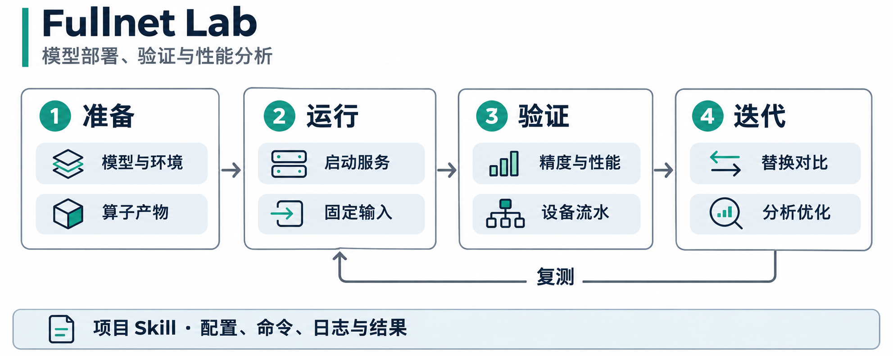

# Fullnet Lab

**通过 AI 完成模型部署、精度验证、性能分析与算子替换。**

Fullnet Lab 将整网实验组织为可执行的工作流程。你提供模型、设备和任务目标，具备终端与文件操作能力的 AI 按项目 Skill 检查环境、运行任务、处理错误并整理结果。模型配置、代码变更和实验结果分别保存，便于复现与对比。

[开始使用](#让-ai-开始工作) · [工作流](#工作流) · [项目 Skills](#项目-skills) · [文档与安装](#文档与安装)

## 让 AI 开始工作

### 1. 获取项目

```bash
git clone https://github.com/JPWang-CS/vllm.git fullnet-lab
cd fullnet-lab
```

使用能读取仓库文件、执行终端命令并连接目标环境的 AI 编程助手，打开这个目录。项目的 [AGENTS.md](AGENTS.md) 提供工作入口，`.agents/skills/` 定义各项任务的执行方法。

### 2. 告诉 AI 你的目标

复制下面的任务说明，填入实际信息：

```text
请阅读 AGENTS.md，使用项目 Skill 完成模型部署与验证。

模型：模型名称、发布版本或已有权重目录
硬件：设备型号、可使用的设备，以及 A2/A3/A5 平台
工作范围：目标连接、个人容器和项目目录
运行环境：已有模型 Python 环境与 CANN 入口；也可由你核对后准备项目私有环境
评测目标：使用指定数据集；已有评测协议时沿用其输入、生成参数和评分规则

请先检查环境与权重，启动服务并完成一个真实生成请求。
随后验证精度、采集性能与设备流水，保存原始结果和可复现命令。
根据首个错误自行定位并修复项目内的问题，继续执行后续步骤。
在指定容器和项目目录中工作，复用现有环境，并保留每次尝试的记录。
```

AI 会根据实际模型和运行时准备配置。仓库提供 Ascend A2/A3/A5 配置入口；部署参数、模型适配和 profiler 由所选环境决定。A2、A3、A5 的基础功能都要在目标平台上重新完成健康、映射、启动、短请求和固定评测；平台之间不直接复用设备或性能结果。模型安装、权重获取和数据准备见 [从零准备环境与模型](docs/from-zero.md)。

### 3. 查看结果并继续任务

每次实验都保存配置、固定输入、日志、输出与报告。你可以继续要求 AI：

```text
读取这次实验的结果，解释主要性能瓶颈，并给出下一项可验证的改动。
```

或接入自己的算子包：

```text
在项目私有环境中接入这个算子包，找到模型中的实际调用位置。
保留原生基线，用相同输入验证替换后的数值与性能，解释对整网的影响。
```

## 工作流



AI 先读取项目规则、模型说明和对应 Skill，再核对原始配置、运行时加载路径、权重、设备健康与空闲状态。随后固定输入和生成协议，独立完成真实短生成、固定评测、服务性能和设备 profile；每个阶段保留原始日志、退出码和失败原因。修改或算子替换必须创建独立实验，并与原生基线使用相同条件对照。

公开 CLI 的阶段入口是：

```bash
fullnet run --model <model> --run <run> [--profile] [--performance]
fullnet run --model <model> --run <run> --pd-probe mixed
fullnet run --model <model> --run <run> --pd-probe split
```

`--pd-probe split` 在固定评测前检查 KV 交接；`--pd-probe mixed`、`--profile` 和 `--performance` 在固定评测通过后执行。前两个 flag 要求冻结配置中已经有合法的 `measurements`；`--profile` 还要求服务端 profiler 已在配置中启用。修改这些字段后必须重新执行 `fullnet plan`，不能对已经开始的实验临时补配置。`mixed` 只适用于同一服务实例确实能提供混合 P/D 证据；`split` 需要实际的 producer/consumer、KV-transfer 和 `/metrics_snapshot` 适配器，普通单服务配置不能直接使用。

真实设备运行时，配置中的 `devices` 是进程使用的 runtime/logical device selector，不等同于 `npu-smi` 的物理 board ID。A2/A3/A5 运行前都要取得当前 host 上的物理到 runtime/ACL 映射，再重新确认目标设备健康、空闲且没有本任务外的进程；这次 fresh gate 通过后才可启动模型。换卡或换平台必须建立新的实验。

## 可以完成哪些工作

| 工作 | 执行内容 | 主要产物 |
|---|---|---|
| 模型部署 | 核对环境、获取或复用权重、配置服务、发送真实请求 | 启动配置、服务日志、请求响应 |
| 精度验证 | 固定输入、模板与生成参数，评分或进行数值对照 | 分项得分、失败样本、误差记录 |
| 性能分析 | 测量请求时延与吞吐，采集设备计算和通信记录 | 性能摘要、设备 trace、瓶颈分析 |
| 算子替换 | 加载独立算子产物，在模型调用点接入并与原生对照 | 加载与命中记录、精度及性能对比 |
| 调试与优化 | 根据首错定位问题，修改后复测，记录模型收益 | 修复说明、复现步骤、对照报告 |

外部算子可以来自独立算子库、Ascend C 工程或其他扩展项目。算子仓负责构建产物，Fullnet Lab 负责模型接入与整网验证，具体接入方式见 [外部算子接入](docs/operator-replacement.md)。

模型、配置、变更、基线和实验按[模型与实验目录规范](docs/repository-layout.md)组织。新增模型先建立 `models/<model>/model.yaml` 和 `README.md`；新增部署继续使用原模型目录，实验写入该模型的 `experiments/<run-id>/`。

## 项目 Skills

AI 按任务读取对应 Skill，也可以沿部署、验证、分析和优化的顺序连续执行。

| Skill | 适用任务 |
|---|---|
| [fullnet-validate](.agents/skills/fullnet-validate/SKILL.md) | 环境检查、模型启动与精度验证 |
| [fullnet-profile](.agents/skills/fullnet-profile/SKILL.md) | 整网与设备性能采集 |
| [fullnet-debug](.agents/skills/fullnet-debug/SKILL.md) | 定位启动、执行、通信和数值问题 |
| [fullnet-replace](.agents/skills/fullnet-replace/SKILL.md) | 接入外部算子并建立原生对照 |
| [fullnet-optimize](.agents/skills/fullnet-optimize/SKILL.md) | 根据整网热点设计并验证优化 |

## 文档与安装

Python 3.10 或更新版本。在项目中创建框架环境：

```bash
python3 scripts/bootstrap.py --extras download,evaluation
source envs/fullnet/bin/activate
fullnet doctor
```

框架环境负责配置、任务管理与结果分析；模型计算使用运行配置中指定的推理环境。安装脚本支持缺少系统 pip 的 Python，离线安装与已有模型环境的使用方法见 [安装说明](docs/from-zero.md)。

AI 生成本机配置后，也可以用命令行复现部署与评测过程。先用仓库内的 HTTP fixture 检查框架流程：

```bash
fullnet check --config examples/offline/config.yaml
fullnet plan --config examples/offline/config.yaml --run workflow-001
fullnet run --model workflow-fixture --run workflow-001
fullnet report --model workflow-fixture --run workflow-001
```

每次任务的配置、输入、日志、输出和报告都保存在项目目录。结果查看与后续分析可以继续交给 AI；后台任务提交与恢复见 [长任务与 AI 执行](docs/background-jobs.md)。

`fullnet run` 的退出码 0 表示框架任务和评测协议完成，并不自动表示质量通过。评分阈值为 `null` 时，结果会保留 `quality_status=not_specified`；外部 CI 或交付脚本必须同时检查结果中的 `protocol_pass`、`quality_status`、profile、performance 和 cleanup 状态。只有明确的质量阈值满足后，才能把质量记为 `passed`。

## 使用文档

| 想了解的内容 | 文档 |
|---|---|
| 安装框架、准备模型与数据 | [从零准备环境与模型](docs/from-zero.md) |
| 设置输入、评分与数值比较 | [运行与评测](docs/evaluation.md) |
| 保存长任务并在断线后恢复 | [长任务与 AI 执行](docs/background-jobs.md) |
| 接入 wheel、OPP 包或动态库 | [外部算子接入](docs/operator-replacement.md) |
| 组织性能采样与设备分析 | [性能分析](docs/profiling.md) |
| 查看模型配置与适配入口 | [模型目录](models/) |
| 模型、配置和实验目录规范 | [模型与实验目录规范](docs/repository-layout.md) |
| 部署矩阵与完整验收条件 | [部署验证](docs/deployment-validation.md) |
| 按阶段定位失败 | [调试方法](docs/debugging.md) |

## License

[Apache License 2.0](LICENSE)
